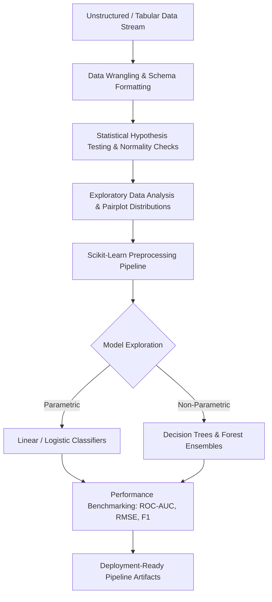

<div align="center">


[](https://www.python.org/)
[](https://pandas.pydata.org/)
[](https://scikit-learn.org/)
[](#)
[](#)

</div>

---

## 📌 Executive Summary / Overview

The **Applied Data Science Ecosystem** (`DATA-SCIENCE`) is a central repository for predictive analytics, exploratory statistical modeling, and computational data mining.

The repository serves as a foundational proving ground for applied data intelligence: exploring non-linear relationships across multivariate features, constructing high-throughput Pandas ETL transformations, conducting parametric hypothesis testing, and validating machine learning predictive baselines.

---

## 📖 Interactive Table of Contents

- [Executive Summary / Overview](#-executive-summary--overview)
- [Key Features & Capabilities](#-key-features--capabilities)
- [System Architecture & Analytics Life Cycle](#-system-architecture--analytics-life-cycle)
- [Tech Stack Breakdown](#-tech-stack-breakdown)
- [Pillars of Applied Data Science](#-pillars-of-applied-data-science)
- [Reproducible Quickstart & Setup](#-reproducible-quickstart--setup)
- [Project Directory Layout](#-project-directory-layout)
- [Author & Contributions](#-author--contributions)

---

## ✨ Key Features & Capabilities

- **Vectorized Data Transformation**: Utilizes optimized NumPy and Pandas C-underpinned memory vectors for high-efficiency tabular operations.
- **Statistical Distribution Profiling**: Evaluates normality (Shapiro-Wilk tests), skewness, and kurtosis across empirical observation sets.
- **Dimensionality Reduction & Compression**: Applies Principal Component Analysis (PCA) to decouple correlated variables and reduce feature spaces.
- **Modular Predictive Pipelines**: Cleanly chains data transformation (`StandardScaler`, `OneHotEncoder`) with downstream estimators using Scikit-Learn `Pipeline`.
- **Interpretability & Feature Importance**: Quantifies feature contributions via Gini impurity metrics and regression coefficients.

---

## 🏗️ System Architecture & Analytics Life Cycle



---

## 🛠️ Tech Stack Breakdown

| Category | Technologies & Tools |
| :--- | :--- |
| **Language** | Python 3.9+ |
| **Tabular Computing** | Pandas, NumPy |
| **Machine Learning** | Scikit-Learn (Pipelines, Estimators, Metrics) |
| **Data Visualization**| Seaborn, Matplotlib |
| **Notebook Systems** | JupyterLab, Google Colab |

---

## 📊 Pillars of Applied Data Science

| Pillar | Focus | Practical Deliverables |
| :--- | :--- | :--- |
| **1. Data Wrangling** | Cleaning, missingness treatment, type casting | Robust data cleansing pipelines |
| **2. Exploratory Analytics**| Correlation analysis, clustering, variance tracking | Seaborn heatmap and pairplot suites |
| **3. Statistical Inference**| Significance tests, confidence intervals, p-values | Validated hypothesis reports |
| **4. Predictive Modeling** | Supervised learning, cross-validation, hyperparameter tuning | Scikit-Learn production pipelines |

---

## 🚀 Reproducible Quickstart & Setup

### Prerequisites
- Python 3.9+

### Step 1: Clone the Repository
```bash
git clone https://github.com/Jeshwanthika07/DATA-SCIENCE.git
cd DATA-SCIENCE
```

### Step 2: Set Up Environment
```bash
python -m venv venv
# On Windows:
.\venv\Scripts\activate
# On Linux/macOS:
source venv/bin/activate

pip install numpy pandas scikit-learn matplotlib seaborn jupyterlab
```

---

## 📂 Project Directory Layout

```text
DATA-SCIENCE/
│
├── README.md                  # Comprehensive ecosystem documentation
└── LICENSE                    # Open-source MIT license
```

---

## 👩‍💻 Author & Contributions

Authored by **[Jeshwanthika Pothamchetty](https://github.com/Jeshwanthika07)**  
*Alliance University | Department of Computer Applications*

<div align="center">


</div>
